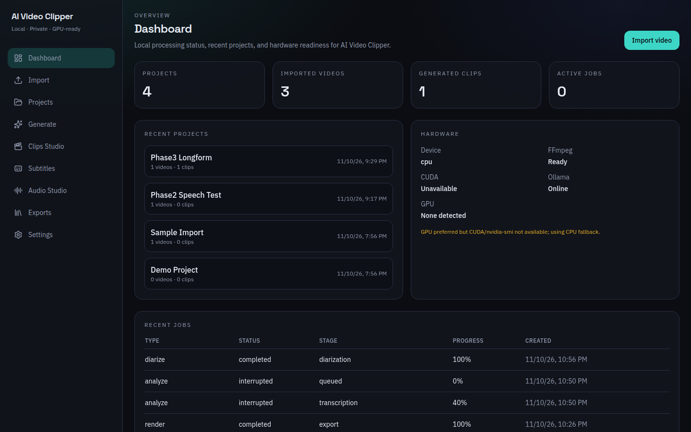
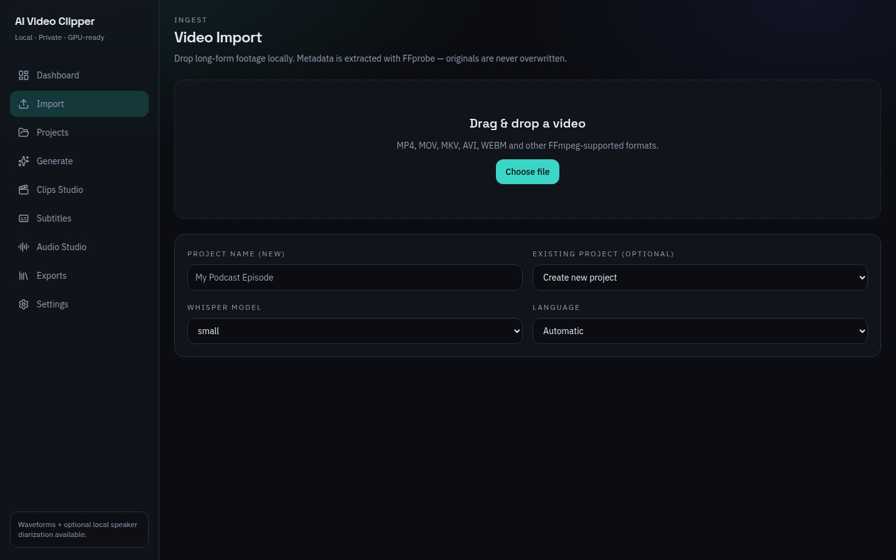
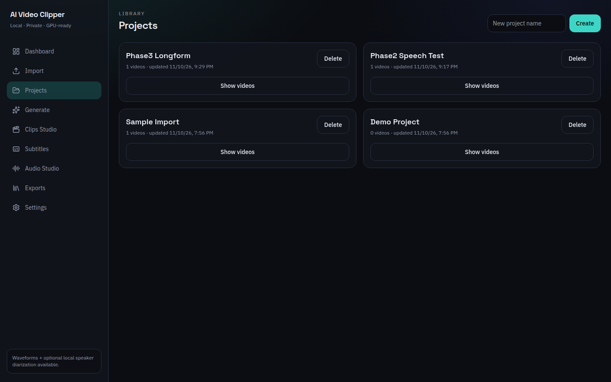
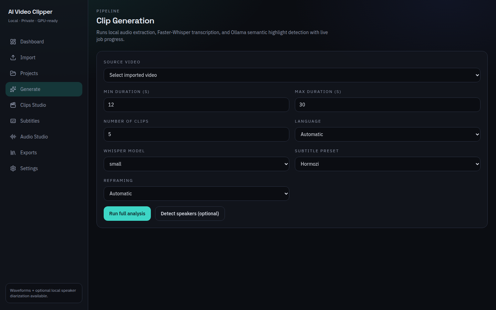
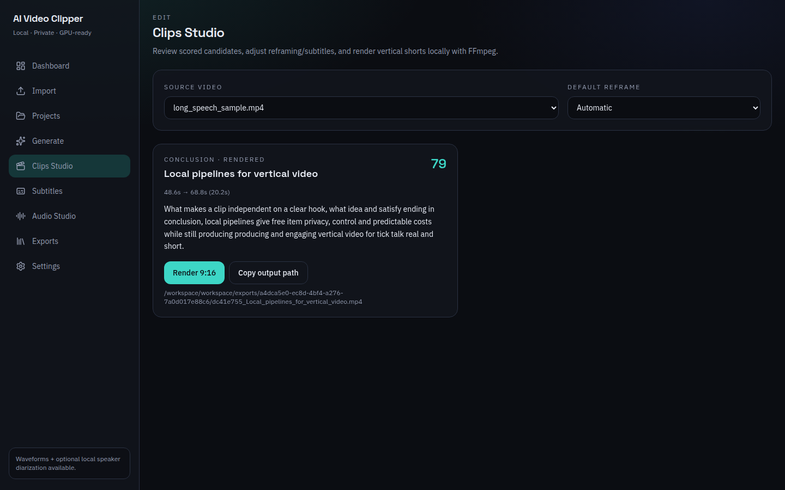
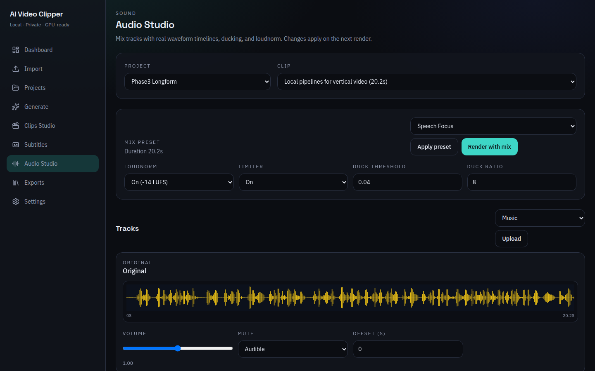
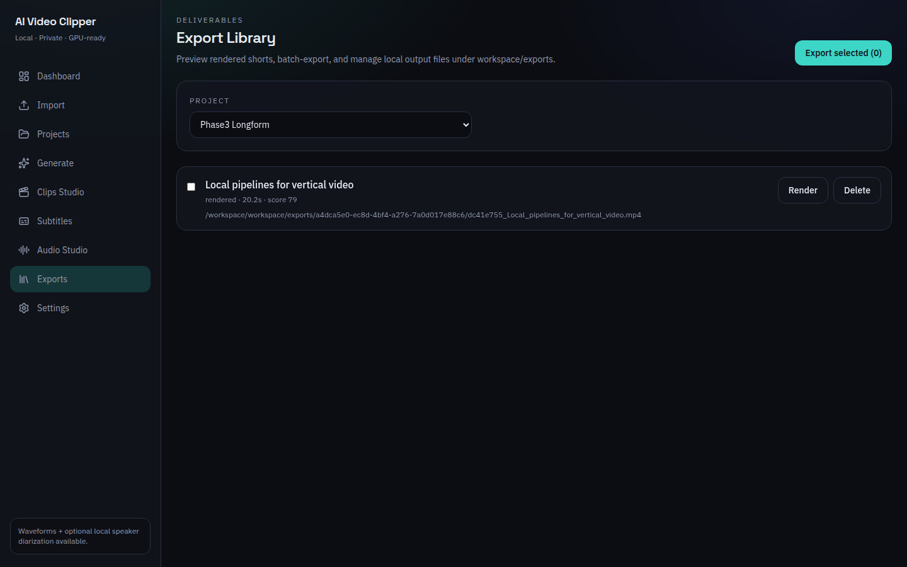
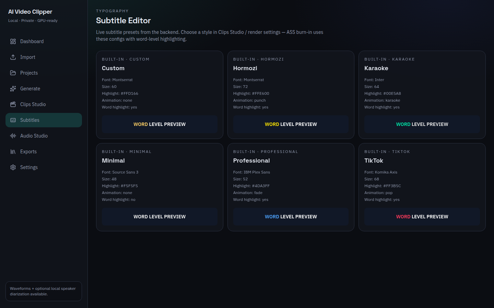
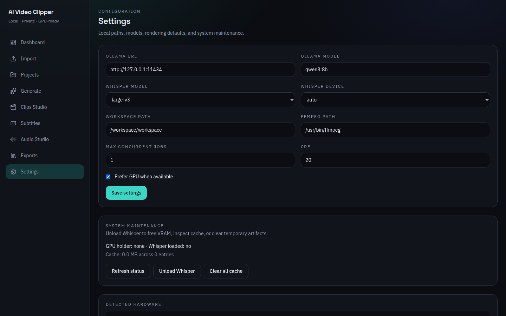

# Guía de uso — AI Video Clipper (ClipForge)

Tutorial paso a paso para usar la aplicación en local (desarrollo en navegador o instalador desktop).  
Todas las capturas se tomaron de la UI real.

---

## 1. Arrancar la app

### Modo desarrollo (navegador)

```powershell
cd C:\Users\PC\Documents\python\ClipForge
.\scripts\Start-Dev.ps1
```

- UI: http://127.0.0.1:4200  
- API: http://127.0.0.1:8000/docs  

### Modo desktop (instalador)

```powershell
.\scripts\Build-Release.ps1
explorer .\desktop\angular-app\src-tauri\target\release\bundle\nsis
```

Instala el `.exe` (p. ej. `AI Video Clipper_0.6.0_x64-setup.exe`) y ábrelo.

Antes de generar clips, ten **Ollama** en marcha y el modelo tirado:

```powershell
ollama pull qwen3:8b
ollama serve
```

---

## 2. Dashboard (inicio)



Desde aquí ves:

- Contadores: proyectos, videos, clips, jobs activos  
- Proyectos recientes  
- Estado de hardware (FFmpeg, CUDA, Ollama)  
- Jobs recientes (analyze / render / diarize)

Pulsa **Import video** o usa el menú lateral **Import**.

---

## 3. Importar un video



1. Arrastra un archivo (MP4/MOV/MKV/…) o **Choose file**  
2. Escribe un **Project name** (o elige un proyecto existente)  
3. Elige modelo Whisper (`small` en CPU; `large-v3` si tienes GPU)  
4. Idioma: **Automatic** o fijo  
5. Importa el video  

El original se copia a `workspace\originals\` sin modificarlo.

---

## 4. Proyectos



Lista tus proyectos con conteo de videos/clips. Útil para organizar episodios o canales.

---

## 5. Generar clips (análisis)



1. Menú **Generate**  
2. Selecciona el **Source video**  
3. Ajusta:
   - duración min/max en **segundos** (p. ej. 12–30 s, no minutos)  
   - número de clips  
   - idioma / Whisper / preset de subtítulos / reframe  
4. Pulsa **Run full analysis**  

El job hace: extracción de audio → Whisper → Ollama (hooks) → candidatos.

### Diarización opcional (varios hablantes)

En la misma pantalla: **Detect speakers**.

- Motor **local**: sin token, gratis  
- **pyannote** (opcional): `pip install -r backend\requirements-optional.txt` + `AVC_HF_TOKEN`  
  Token gratis: https://huggingface.co/settings/tokens  

No es obligatorio si solo hay un narrador.

---

## 6. Clips Studio (revisar y render)



1. Elige el video fuente  
2. Revisa candidatos (score, hook, tiempos, transcript)  
3. Elige modo de reframe (Automatic / smart crop / center / blurred)  
4. Pulsa **Render 9:16**  

El MP4 vertical (1080×1920) queda en `workspace\exports\...`.  
Puedes **Copy output path** para abrirlo en el explorador.

---

## 7. Audio Studio (mezcla)



1. Elige **Project** y **Clip**  
2. Ajusta preset (`Speech Focus`, `Balanced`, `Music Bed`)  
3. Sube música / voice-over si quieres  
4. Controla volumen, mute, ducking, loudnorm  
5. **Render with mix**  

Verás waveforms reales por pista.

---

## 8. Export Library



1. Selecciona proyecto  
2. Marca clips  
3. **Export selected** (copia/batch bajo `workspace\exports\...\batch\`)  
4. Render o delete individuales si hace falta  

---

## 9. Subtitle Editor



Consulta los presets locales (Hormozi, Karaoke, TikTok, Minimal, Professional, Custom).  
El estilo se aplica al render (ASS con highlight por palabra).

---

## 10. Settings



Configura:

- Ollama URL / modelo  
- Whisper model / device  
- Workspace y FFmpeg  
- CRF / jobs concurrentes / prefer GPU  

**System maintenance:**

- Refresh status  
- Unload Whisper (libera VRAM)  
- Clear all cache  

---

## Flujo rápido recomendado

```text
Import → Generate (análisis) → Clips Studio (Render 9:16)
        ↘ Audio Studio (opcional) → Render with mix
        ↘ Export Library
```

## Dónde están los archivos

| Carpeta | Contenido |
|---------|-----------|
| `workspace\originals\` | Videos importados |
| `workspace\projects\` | DB SQLite + audio de pistas |
| `workspace\temporary\` | Caches, ASS, extracciones |
| `workspace\exports\` | MP4 finales |

## Problemas frecuentes

| Síntoma | Qué hacer |
|---------|-----------|
| Ollama offline | `ollama serve` y `ollama pull qwen3:8b` |
| Whisper muy lento | Usa modelo `small`/`medium` o GPU CUDA |
| `cublas64_12.dll is not found` | Falta el runtime CUDA 12. ClipForge cae a CPU automáticamente; o instala [CUDA Toolkit 12.x](https://developer.nvidia.com/cuda-downloads) y reinicia, o en Settings pon Whisper device = `cpu` |
| Render falla | Revisa FFmpeg en PATH / Settings |
| Sin clips | Ejecuta Generate hasta status `completed` |
| Build Tauri | Usa PowerShell **sin admin**; Python 3.12 recomendado |

Más detalle técnico: [README](../README.md) · [PACKAGING](PACKAGING.md) · [API](API.md)
